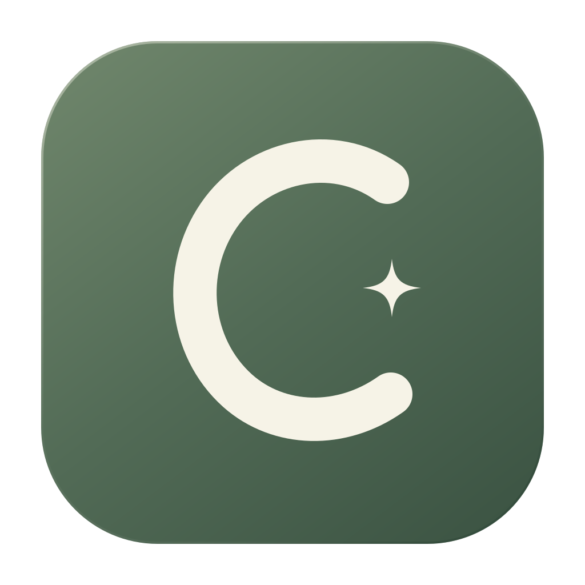
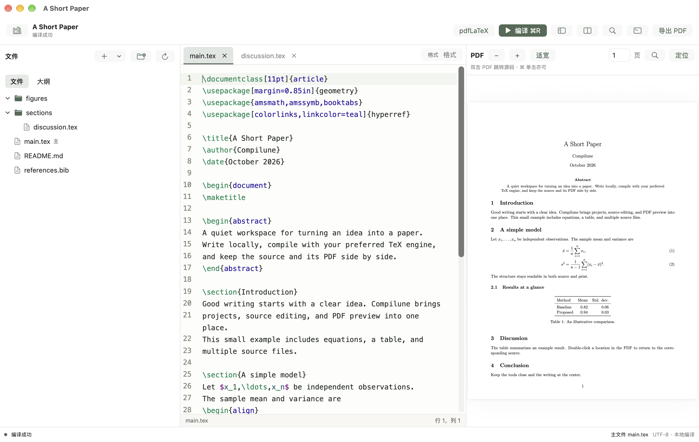
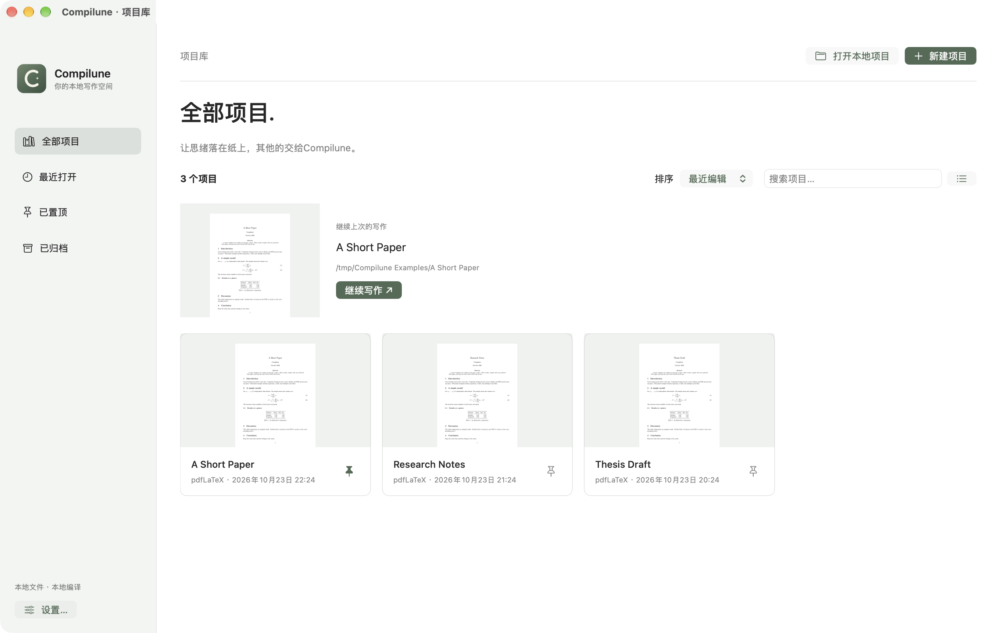
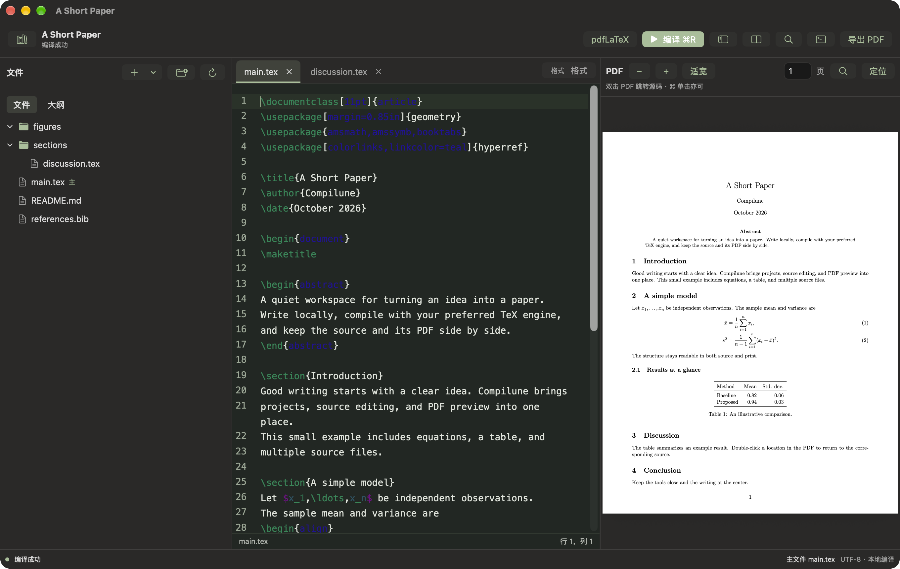
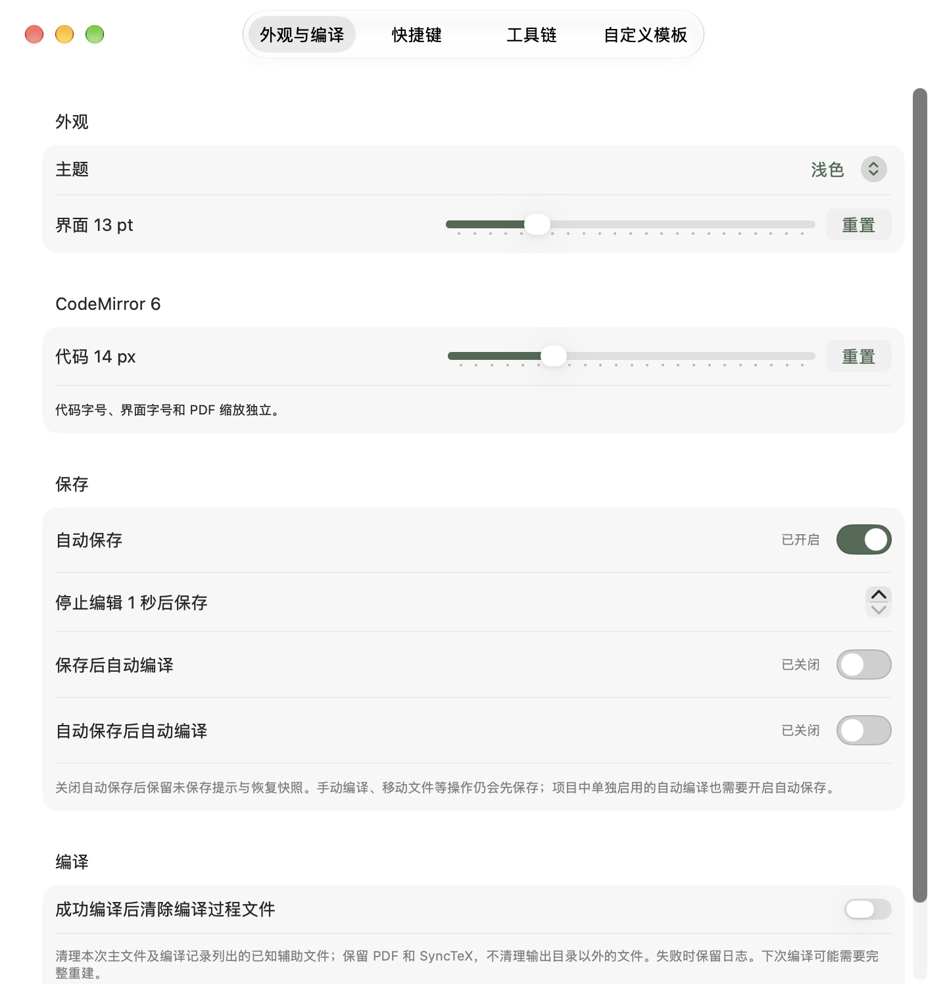

<p align="center"></p>

# Compilune

**本地编写、编译和预览 LaTeX，提供 macOS 版与开发中的 Windows 预览版。**

[English](README.md) · 简体中文

Compilune 从项目库开始，将 CodeMirror 6 源码编辑器、本地编译和 PDF 预览整合到原生 macOS 工作区。项目最初为个人写作开发，现以 MIT 协议分享。

当前版本：**0.2.10**。应用界面目前以**简体中文**为主，内置补全说明和默认文稿模板使用英文。

## 下载

**[前往 GitHub Releases 下载安装包](https://github.com/JiaQi1996/FolioTex/releases)**

根据操作系统与处理器选择安装包：

| 平台 | 处理器 | 安装包文件名后缀 |
| --- | --- | --- |
| macOS | Apple 芯片（M 系列） | `-arm64.dmg` |
| macOS | Intel | `-x86_64.dmg` |
| Windows 预览版 | ARM64 | `-windows-arm64-setup.exe` |
| Windows 预览版 | Intel / AMD 64 位 | `-windows-x64-setup.exe` |

可下载的版本与平台以各次发布附带的文件为准。可同时下载对应的 `.sha256` 文件校验安装包。macOS 打开 DMG 后，将 Compilune 拖入「应用程序」。TeX 发行版仍需单独安装。

## macOS 运行截图

以下为 macOS 应用的实际运行画面，使用独立演示项目。当前应用界面以简体中文为主。

**编辑与 PDF 预览**：本地编译、文件树、源码与 PDF 并排显示。



**项目库**：继续上次写作、置顶常用项目，或打开本地文件夹。



<details>
<summary>查看深色模式</summary>



</details>

<details>
<summary>查看外观、字号、自动保存与编译设置</summary>



</details>

## 功能

- **项目库**：打开本地文件夹、置顶、排序、PDF 封面预览、归档、重新关联移动后的文件夹。
- **源码编辑**：CodeMirror 6 语法高亮，命令、环境、自定义宏、文献、标签和文件路径补全。环境片段同步编辑 `begin` / `end` 名称，按 Enter 跳到正文。
- **写作工具**：可展开的格式与插入工具栏、可自定义的快捷键、命令面板、快速打开、行列跳转和定义跳转。格式操作生成 LaTeX 源码，编辑区不是渲染后的所见即所得文稿。
- **查找替换**：文件内支持正则；项目内普通文本搜索、替换预览，以及跨文件替换的整体撤销。
- **文件导航**：文件夹优先、分级缩进、新建文件夹/TeX/Bib、项目内拖动移动文件，以及默认展开、点击跳转的 `.tex` 大纲。
- **本地编译**：latexmk 配合 pdfLaTeX、XeLaTeX 或 LuaLaTeX；可设置主文件、工作/输出目录、指定 rc 文件与 shell escape。
- **PDF 预览**：查找、缩放、页码、上次成功预览缓存和双向 SyncTeX。双击 PDF 跳转源码，源码中按 `⌘⇧J` 定位 PDF。
- **保存策略**：可选自动保存及 1–30 秒等待时间；手动保存后编译、自动保存后编译分别设置；未保存确认与恢复快照。
- **个性设置**：实时跟随系统外观、独立浅色/深色主题、界面与代码字号均通过 8–30 滑动条调整、本地自定义模板，以及可选的编译过程文件清理。
- **工具链**：自动检测 TeX 环境、提供发行版下载入口，并附带运行 `latexmk` 所需的私有 Perl；TeX 发行版仍需单独安装。

编辑和编译均在本地执行。编辑器 bundle、图标与私有 Perl 随应用打包，安装后无需 Node.js。所需 TeX 宏包和字体安装齐全后，写作与编译可离线使用；下载发行版、更新及 MiKTeX 按需安装宏包时需要网络。

## 平台状态

采用一个仓库、各平台独立目录的结构，公共编辑器放在共享包中。

| 平台 | 目录 | 当前状态 |
| --- | --- | --- |
| macOS | [`apps/macos/`](apps/macos/README.md) | 已实现，提供 Apple 芯片与 Intel 构建 |
| Windows | [`apps/windows/`](apps/windows/README.md) | 预览版；已在 Windows 11 ARM64 上验证 ARM64 原生与 x64 仿真版本 |
| Linux | [`apps/linux/`](apps/linux/README.md) | 计划移植，暂无可运行应用 |
| HarmonyOS | [`apps/harmonyos/`](apps/harmonyos/README.md) | 计划移植，暂无可运行应用 |

[`packages/editor/`](packages/editor/README.md) 存放公共编辑器。Windows 已实现窗口、文件、编译进程与 PDF.js 适配；现有 SwiftUI/AppKit/PDFKit 代码属于 macOS。详细边界见[平台移植计划](docs/PLATFORMS.md)。

## macOS 系统与芯片支持

| 项目 | 要求 / 状态 |
| --- | --- |
| 系统 | macOS 14 及以上 |
| Apple 芯片 | `arm64`，已在 Apple Silicon 上构建并验证核心与集成功能 |
| Intel 芯片 | `x86_64`，已交叉编译；附带的 Perl 与编译流程通过 Rosetta 验证，尚未在 Intel Mac 实机验证 |
| LaTeX | 本地 TeX 发行版，包含 `latexmk`、所选引擎和 `synctex` |
| 构建应用 | Xcode 或 Swift Command Line Tools，Swift 5.9+；本项目使用 Swift 6.4 验证 |
| 修改网页编辑器 | Node.js 18+ 与 npm |

脚本分别生成各芯片版本，目前不是 Universal 二合一应用。Intel 的运行兼容性仍需 Intel Mac 实测。

## 开始使用

1. 在 [Releases](https://github.com/JiaQi1996/FolioTex/releases) 选择匹配芯片的 macOS DMG，或按下方说明从源码构建。Apple 芯片选择 `arm64`，Intel 选择 `x86_64`，打开 DMG 后将 Compilune 拖入「应用程序」。
2. 启动后进入项目库，选择「打开本地项目」，或用「新建项目」创建内置英文 `article` 文稿。
3. 安装 MacTeX 或其他适用的 TeX 发行版。在「设置 → 工具链」检测环境或指定可执行目录，MacTeX 通常为 `/Library/TeX/texbin`。
4. 在项目「配置」中选择主 `.tex` 文件与引擎，按 `⌘R` 编译。

本地打包使用 **ad-hoc 签名**，尚未进行 Developer ID 分发签名与公证。从网络下载的版本可能需要在 macOS 中明确允许打开。

### 保存与自动编译

自动保存默认开启，等待 1 秒；两个全局保存后编译选项默认关闭。「保存后自动编译」对应手动保存，与自动保存开关独立；「自动保存后自动编译」及项目级自动编译均需要开启自动保存。只有写盘成功后才触发相应编译，正在构建时最多排队一次后续构建。

项目库与项目窗口互斥：打开项目关闭项目库，返回项目库关闭项目；有未保存内容时提供「保存并关闭／不保存／取消」。取消会保留当前项目。关闭项目或退出时也会确认未保存内容。「不保存」不会回滚已经自动保存到磁盘的修改。关闭定时自动保存后，手动编译、移动文件和关闭文件选项卡等操作仍可能先保存缓冲。

### PDF 定位与清理

双向定位依赖最新源码成功编译生成的 SyncTeX。旧缓存或修改前的 PDF 需要先重新编译；定位通常精确到源码行，空白、公式或宏展开位置可能存在偏差。

开启清理后，只在编译成功时移除已识别的辅助文件，保留 PDF、SyncTeX 与源文件；失败时保留诊断文件。清理会减少增量缓存，下次编译可能变慢。

## TeX 发行版与私有 Perl

应用附带 **Perl 5.42.3**，供 `latexmk` 按需使用，Windows MiKTeX 用户无需再单独安装 Perl。**TeX 发行版仍需另装。**

| 平台 | TeX 选择 | Perl 使用方式 |
| --- | --- | --- |
| macOS | MacTeX，或兼容的 MiKTeX 安装 | 优先保留可用的 MacTeX／系统解释器；原生私有 Perl 作为备用，MiKTeX 优先使用私有 Perl |
| Windows | TeX Live（推荐完整安装），或 MiKTeX（初始体积较小，联网按需安装宏包） | TeX Live 沿用自身环境；MiKTeX 使用随应用附带的私有 Perl |

私有运行时只影响编译子进程，不修改全局 `PATH`。macOS 两种安装包分别包含对应芯片的原生 Perl；Windows ARM64 安装包中的 Perl 为 x64，通过 Windows 11 仿真运行。「设置 → 工具链」可查看运行时信息。详见[运行时设计、构建、许可与限制](docs/PERL_RUNTIME.md)。

### 自定义模板

导入模板会复制到应用的本地模板库，成功导入后删除原始文件夹仍可使用；新建项目再复制一份，修改项目不影响模板。请将图片、PDF 图片、cls、sty、bib 等依赖放在模板文件夹内。软件更新保留模板库。

## 从源码构建

以下命令在仓库根目录执行；Swift Package 位于 `apps/macos/`，用 Xcode 开发时打开该目录。尚未安装 Apple 开发工具时先运行：

```sh
xcode-select --install
./scripts/build-app.sh
```

构建的 App 保存在已忽略的本地目录：`apps/macos/.build-arm64/artifacts/Compilune-arm64.app` 或 `apps/macos/.build-x86_64/artifacts/Compilune-x86_64.app`。

仓库已包含离线编辑器 bundle，仅构建原生应用无需安装 npm 依赖。构建脚本会准备固定版本的私有 Perl，首次构建需要下载并校验源码，以及额外编译时间；也可按[私有 Perl 文档](docs/PERL_RUNTIME.md)提供离线归档。修改 `packages/editor/src.js` 后，先重新生成：

```sh
npm --prefix packages/editor ci
npm --prefix packages/editor run build
./scripts/build-app.sh
```

编辑器构建也会更新依赖许可证清单；提交时请同时包含源码、重新生成的 bundle 和许可证变更。

### Intel 构建与安装包

```sh
# 使用支持 x86_64 的 macOS SDK 交叉编译 Intel 应用。
./scripts/build-app.sh --arch x86_64

# 为当前机器芯片构建并生成 DMG 与 SHA-256 校验文件。
./scripts/package.sh

# 明确生成 Intel DMG 与校验文件。
./scripts/package.sh --arch x86_64
```

仓库根目录 `dist/` 统一存放 macOS 与 Windows 发布文件。macOS 打包输出 `arm64`、`x86_64` 两个 DMG 及各自的 `.sha256` 校验文件；Windows 打包输出 ARM64、x64 两个 EXE 及对应校验文件。每份校验文件仅包含对应 DMG；可在 `dist/` 内运行 `shasum -a 256 -c Compilune-0.2.10-arm64.sha256` 校验，Intel 版替换相应文件名。打包脚本检查应用签名与 DMG 完整性，并生成 SHA-256 校验文件。版本号位于 `VERSION`，可通过 `COMPILUNE_BUILD_NUMBER` 指定应用构建号（兼容旧变量 `FOLIO_BUILD_NUMBER`）。默认使用 ad-hoc 签名，也可通过 `COMPILUNE_SIGN_IDENTITY` 指定分发签名身份；当前发布验证未包含 Developer ID 签名与公证。

脚本使用经本机 Command Line Tools 验证的 SwiftPM `native` 后端；新版 Swift 会提示该后端已弃用，本机当前仍可成功构建。代码中的显式 property-wrapper 别名用于绕过该环境缺少 SwiftUI macro 插件的问题。

## Windows 预览版与界面统一

布局和交互遵循[跨平台界面规范](docs/INTERFACE.md)，以现有 macOS 为基准。Windows 共用网页工作区、设计参数及 CodeMirror；macOS 保留原生界面。系统窗口、文件对话框和 ⌘/Ctrl 按平台适配。Windows 已实现文件、编译和 PDF.js 宿主；Linux/HarmonyOS 尚未实现。

详见 [Windows 开发与打包](apps/windows/README.md)。在仓库根目录执行：

```sh
npm --prefix packages/editor ci
npm --prefix apps/windows ci
npm --prefix apps/windows start
# 在 Windows 上打包 ARM64 与 x64：
npm --prefix apps/windows run package
```

x64 对应 Intel/AMD 64 位，不是 32 位 x86。Windows ARM64 原生与 x64 仿真界面流程已通过，安装与启动已验证；Windows 11 ARM64 上 MiKTeX 的真实编译、PDF 预览和双向 SyncTeX 已验证，TeX Live 真实编译尚未验证。两个 EXE 和两份校验统一输出到仓库根目录 `dist/`，与 macOS 的 DMG 和校验文件放在一起。此目录仅保留安装包及对应校验，构建中间产物留在已忽略的 `.build/` 目录。Windows 可选择 TeX Live（推荐完整安装）或 MiKTeX（按需安装），需单独安装。

## 参与开发

提交问题时请附上复现步骤及相关日志，修改公共编辑器后请同步生成资源。此仓库仅包含应用源码、构建脚本和文档，本地验证资料在仓库外单独保留。

## 目录

```text
apps/
  macos/                已实现的原生应用：Package.swift、Sources、scripts
  windows/              Electron 宿主、本地编译、PDF.js 与 ARM64/x64 打包
  linux/                Linux 移植预留，尚未实现
  harmonyos/            HarmonyOS 移植预留，尚未实现
packages/
  editor/               公共 CodeMirror 源码、静态资源、bundle 构建
  workbench/            公共网页项目库、工作区、设置
  design/               配色、布局参数及生成的平台适配
scripts/                构建与打包入口、图标导出、私有 Perl 准备脚本
docs/                   架构、平台计划、快捷键、运行时说明与截图
assets/                 共享软件图标源文件及来源说明
third_party/            私有 Perl 的固定版本与再分发许可说明
```

更多信息：[架构与本地数据](docs/ARCHITECTURE.md)、[快捷键](docs/SHORTCUTS.md)、[更新记录](CHANGELOG.md)。

## 当前限制

- 项目级搜索是忽略大小写的普通文本搜索，正则仅限文件内；项目结果最多 2,000 个匹配行。
- 使用 UTF-8，支持基本 CRLF 保留；其他编码需先转换，混合换行未逐段保留。
- 索引为轻量解析，不解释任意 TeX 宏展开或完整 BibTeX 语法；`.cls` / `.sty` 参与补全，但不显示在侧栏大纲。
- 重命名或移动文件后，不会自动改写正文中的 `\input`、图片或文献路径。
- 外部文件监视约每秒轮询一次；恢复快照保存文本，不保存完整撤销历史。
- 大型 LuaLaTeX/Biber 项目、全部中文字体/宏包组合、旋转页定位及完整辅助功能尚未全面验收。
- 数 GB 的 MacTeX 下载与系统安装流程尚未端到端实测。

## 许可证与致谢

项目原创代码采用 [MIT License](LICENSE)，版权所有 © 2026 JiaQi。

[CodeMirror 6](https://codemirror.net/) 及其运行依赖保留 MIT 许可；[Lucide](https://lucide.dev/) 图标保留 ISC / Feather 声明。完整说明见[第三方依赖](docs/THIRD_PARTY.md)和 `apps/macos/Sources/Compilune/Resources/` 中的许可文件。

随应用附带的 Perl 及其组件保留各自的原始许可，运行时中包含对应声明，详见 [Perl 第三方说明](third_party/perl/README.md)。MacTeX 等 TeX 发行版需单独安装，不随应用分发。Compilune 是独立项目，与 Texifier 没有关联。

## 名称与升级兼容

所有平台统一使用英文名称 **Compilune**，不再使用中文产品名。已有安装会自动沿用原应用数据目录，保留项目库、设置、恢复文件和导入模板；原 bundle/安装器标识及 `.folio` 项目配置保持兼容。

原创图标源文件为 `assets/AppIcon.svg`。需要重新导出 PNG、ICO、ICNS 时，安装 librsvg 的 `rsvg-convert` 后运行 `node scripts/build-icons.mjs`。导出资源已随仓库提交，普通构建无需此工具。
